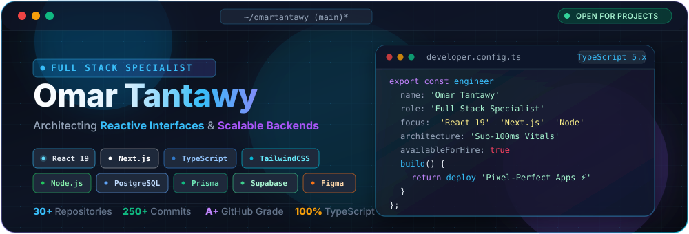

<!-- Minimalist Linear-Style Header -->

  
  &nbsp;
  
  &nbsp;
  
  &nbsp;
  

---

### 👨‍💻 Overview

I'm a **Full-Stack Developer** with a specialized focus on **modern Front-End Architecture**. I build high-performance, accessible, and type-safe web applications using **React 19**, **Next.js (App Router)**, and **TypeScript**, backed by resilient **Node.js** and **PHP** services.

- ⚡ **Front-End Specialization:** Crafting fluid user interfaces with React 19, Next.js Server Components, lightweight Zustand state, and utility-first Tailwind CSS.
- ⚙️ **Backend & APIs:** Architecting RESTful endpoints, auth flows, and microservices with Node.js, Express, and PHP (PDO).
- 🗄️ **Data & Persistence:** Relational schema design and type-safe data access with PostgreSQL, MySQL, Supabase, and Prisma ORM.
- 🎨 **Design Engineering:** Translating Figma prototypes into production-grade design systems with zero visual drift.

---

### 🛠️ Tech Stack

#### Frontend

[-141923?style=flat-square&logo=nextdotjs&logoColor=white)](https://nextjs.org/)

[-141923?style=flat-square&logo=javascript&logoColor=F7DF1E)](https://developer.mozilla.org/en-US/docs/Web/JavaScript)

#### Backend & Databases

[-141923?style=flat-square&logo=php&logoColor=777BB4)](https://www.php.net/)

#### Tooling & Design

---

### 📌 Featured Repositories

  

    
    &nbsp;&nbsp;
    
  

  

    
  

---

### 📊 GitHub Activity & Analytics

  

    
    &nbsp;
    
  

  

    
  

---

Omar Tantawy • Available for contracts & collaborations

