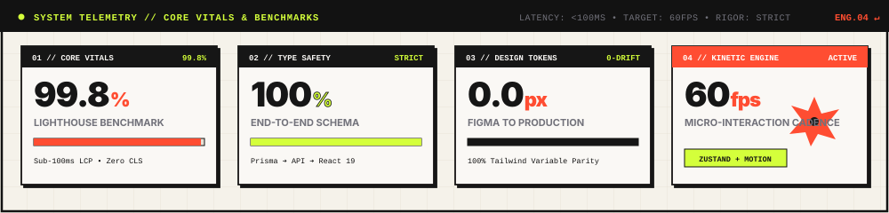

<div align="center">

<!-- Swiss Kinetic / Neo-Brutalist Animated Hero Header -->
<a href="https://omartantawy360.github.io/My-portfolio/">
  
</a>

<br/><br/>

<p align="center">
  <a href="https://omartantawy360.github.io/My-portfolio/"></a>
  &nbsp;
  <a href="mailto:omartantawy360@gmail.com"></a>
  &nbsp;
  <a href="https://github.com/omartantawy360"></a>
  &nbsp;
  <a href="https://www.linkedin.com/in/omartantawy360"></a>
</p>

</div>

---

### 01 // ARCHITECTURAL ETHOS

```yaml
[ SYSTEM SPEC: 2026 // CAIRO, EG • 30.0444° N, 31.2357° E ]
DISCIPLINE  : Frontend Architecture // Kinetic UI // Full-Stack Systems
CORE_FOCUS  : React 19 • Next.js (App Router) • TypeScript • Tailwind CSS
FOUNDATIONS : Node.js • Express • PHP (PDO) • PostgreSQL • Supabase • Prisma ORM
STATUS      : COMMISSIONS OPEN // 100% LIGHT & KINETIC
```

Frontend Developer & UI Architect specialized in crafting **high-performance web applications**, **kinetic micro-interactions**, and **scalable full-stack architectures**. Dedicated to sub-second Core Web Vitals, pixel-perfect design-to-code execution, and type-safe systems from database schema to user interaction.

- ⚡ **Kinetic Front-End:** Precision interfaces engineered with **React 19**, **Next.js (App Router)**, **TypeScript**, and **Tailwind CSS**.
- ⚙️ **Resilient Core:** Clean RESTful APIs, auth pipelines, and backend microservices powered by **Node.js**, **Express**, and **PHP (PDO)**.
- 🗄️ **Data Persistence:** Relational schema modeling and type-safe query generation across **PostgreSQL**, **MySQL**, and **Supabase** via **Prisma ORM**.
- 🎨 **Design Engineering:** Translating **Figma** and **Adobe Illustrator** creative tokens into zero-drift, accessible production code.

---

### 02 // TECHNICAL ARSENAL

#### Frontend Architecture
[](https://react.dev/)
[-121212?style=flat-square&logo=nextdotjs&logoColor=white)](https://nextjs.org/)
[](https://www.typescriptlang.org/)
[-121212?style=flat-square&logo=javascript&logoColor=F7DF1E)](https://developer.mozilla.org/en-US/docs/Web/JavaScript)
[](https://tailwindcss.com/)
[](https://zustand.docs.pmnd.rs/)
[](https://vitejs.dev/)
[](https://developer.mozilla.org/en-US/docs/Web/HTML)
[](https://developer.mozilla.org/en-US/docs/Web/CSS)

#### Backend & Databases
[](https://nodejs.org/)
[](https://expressjs.com/)
[-121212?style=flat-square&logo=php&logoColor=777BB4)](https://www.php.net/)
[](https://www.postgresql.org/)
[](https://www.mysql.com/)
[](https://www.prisma.io/)
[](https://supabase.com/)
[](https://restfulapi.net/)

#### Tooling & Creative
[](https://git-scm.com/)
[](https://github.com/)
[](https://vercel.com/)
[](https://railway.app/)
[](https://www.postman.com/)
[](https://www.figma.com/)
[](https://www.adobe.com/products/illustrator.html)

---

<!-- CENTERPIECE: Swiss Kinetic Telemetry Console -->
<div align="center">
  
</div>

---

### 03 // DEPLOYED WORKS

<div align="center">
  <p align="center">
    <a href="https://github.com/omartantawy360/My-portfolio">
      
    </a>
    &nbsp;&nbsp;
    <a href="https://github.com/omartantawy360/shop-prototype">
      
    </a>
  </p>
  <p align="center">
    <a href="https://github.com/omartantawy360/wave-team">
      
    </a>
  </p>
</div>

---

### 04 // GITHUB METRICS & TELEMETRY

<div align="center">
  <p align="center">
    <a href="https://github.com/omartantawy360">
      
    </a>
    &nbsp;
    <a href="https://github.com/omartantawy360">
      
    </a>
  </p>

  <p align="center">
    <a href="https://github.com/omartantawy360">
      
    </a>
  </p>
</div>

---

<div align="center">

```
[ SPEC: 2026 // SWISS KINETIC ] • OMAR TANTAWY • CAIRO, EG
```

<sub>Available for contracts, high-impact front-end architecture & collaborations.</sub>

</div>
